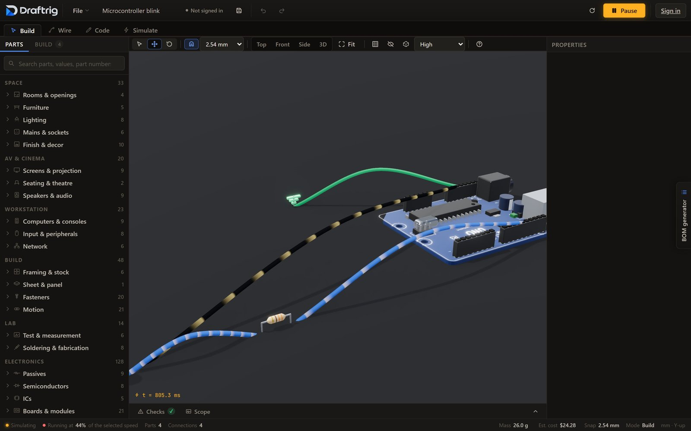

<picture>
  <source media="(prefers-color-scheme: dark)" srcset="https://raw.githubusercontent.com/draftrig/.github/main/profile/logo-dark.png">
  
</picture>

### Draw the room before you buy it.

Draftrig is a 3D planner that runs in your browser. Lay out a desk, a studio, a home cinema or a rack at the sizes you measured, with real gear in it. It shows what fits, how much each socket is drawing and what the whole thing costs.

It also does electronics: wire an Arduino or an ESP32 on a breadboard, run a sketch, and watch the voltages and currents while it runs.

It's free, and you don't need an account.

**[Open Draftrig](https://draftrig.com)** · [Report a bug or request a part](https://github.com/draftrig/feedback/issues/new/choose)

