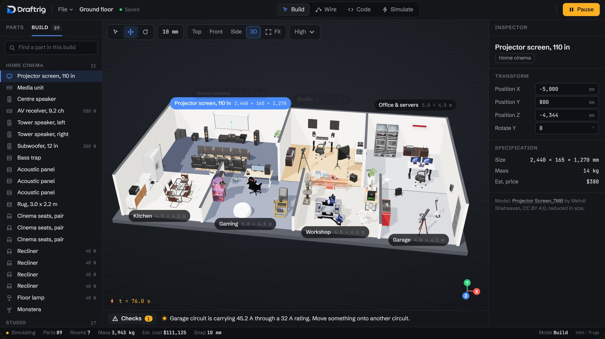

<picture>
  <source media="(prefers-color-scheme: dark)" srcset="https://raw.githubusercontent.com/draftrig/.github/main/profile/logo-dark.png">
  
</picture>

### Plan your setup before you buy it.

Draftrig is a 3D planner for any kind of tech, and it runs in your browser. Lay out a desk setup, a home cinema, a studio, a server rack or an electronics bench with real gear at its real size. It shows what fits, how much each socket is drawing and what the whole thing costs.

For electronics it goes down to the circuit: wire an Arduino or an ESP32 on a breadboard, run a sketch, and watch the voltages and currents while it runs.

It's free, and you don't need an account.

**[Open Draftrig](https://draftrig.com)** · [Report a bug or request a part](https://github.com/draftrig/feedback/issues/new/choose)

The 3D models in this image are by their authors and used under CC BY 4.0. [See the credits](https://github.com/draftrig/.github/blob/main/profile/CREDITS.md).
